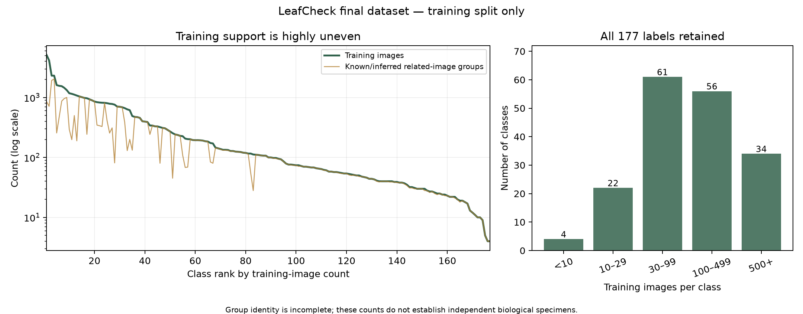
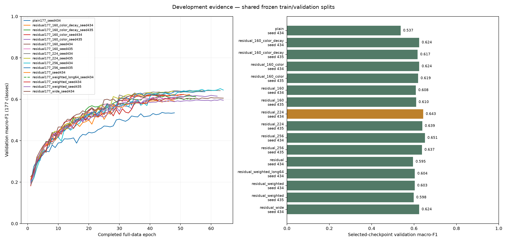
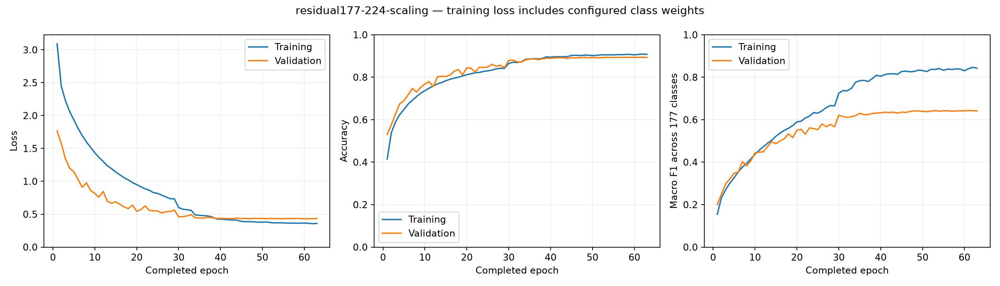
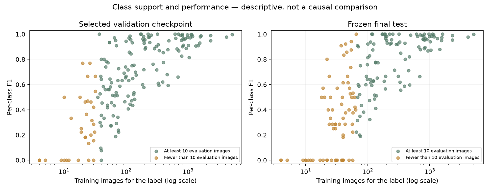
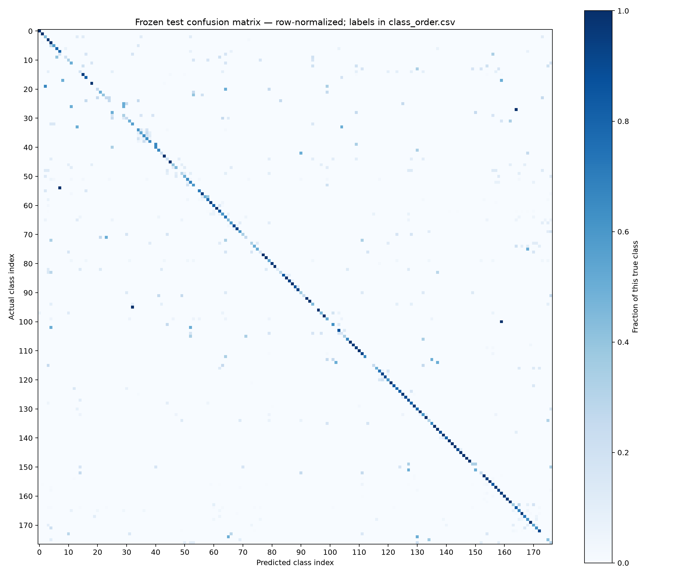
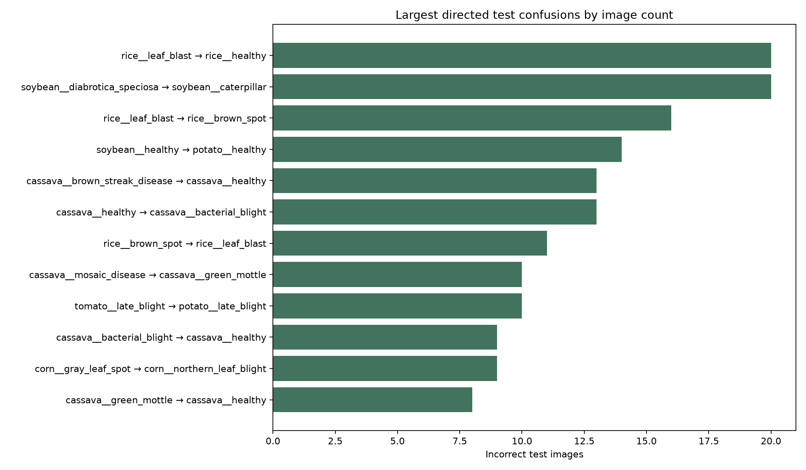
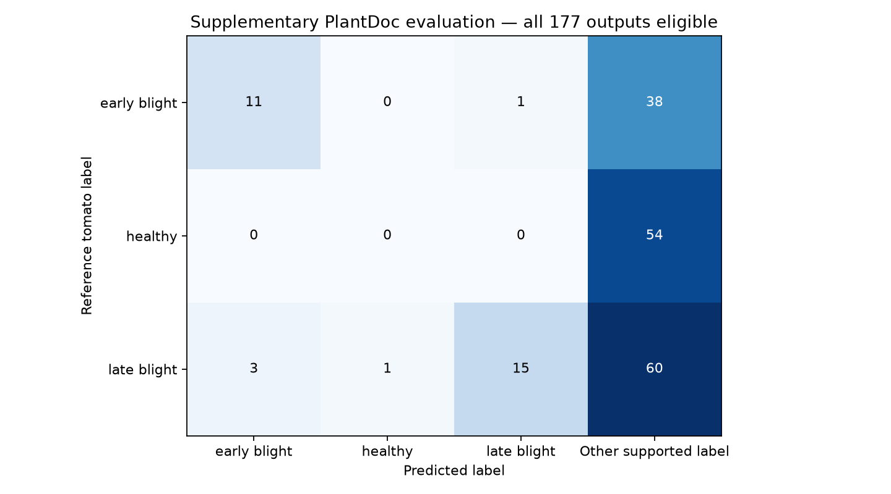

# Plant Health Classification and an Interactive Application

Generated from completed saved records. This is report source material, not a
claim that a formatted 5–10 page report or presentation has been submitted.

## Introduction and related work

LeafCheck classifies a photograph into one of 177 inherited plant-condition
categories. Labels combine crop/species with conditions, including healthy
tissue, disease, pests and some non-leaf plant parts. It is single-label image
classification. The project pairs a randomly initialized custom CNN with an
existing local comparison application. PlantVillage research motivates caution
about controlled-background accuracy versus new photographs [1]. PlantDoc
provides more varied scenes [2]. Residual connections [3] motivate the capacity
experiment; the project does not claim to invent this established technique.

## Contribution and scope

The implemented contribution is an audited 177-label release, shared train/inference
preprocessing, a reproducible custom architecture comparison, validation-led
selection, sealed final evaluation, explicit artifact packaging and a tested
four-model comparison workflow. The older three-tomato-label pilots are preserved
as historical experiments. The earlier MobileNet proposal is superseded; no
pretrained weights are used by the final CNN. Codex-assisted implementation and
execution are disclosed in `contributions.md`; the student must understand and
review the work and follow course policy.

## Dataset and leakage precautions

The release contains 84,269 images across all 177 labels: 59,008 training,
16,836 validation and 8,425 test. The original 90,574-image master is intact.
The audit records 6,305 exclusions with provenance and reasons. Related-image
groups, duplicates and documented prior exposure informed split assignment.
Content IDs provide traceability, not physical plant identity. Training support
ranges from 4 to 5,116 images per label (median 100); 26 labels have fewer than
30 training images. No new downloaded images or generated evaluation images
were added during this final execution. See `final_dataset_audit.md`,
`dataset_summary.json`, `training_class_support.csv` and pinned source manifests.
Source reuse terms must be reviewed before redistribution of the full dataset.

Dataset fingerprint: `4287764ba029d96abaa0532d7e1d14d2656cadc774f445be7785b03b69d2903c`.

## Methods and preprocessing

The selected model is `residual_v1`, seed 434,
with 724,713 trainable parameters. The table below traces a
zero-input software check; shape/parameter derivations are in
`model_defense_guide.md`. It uses a stride-2 convolutional stem, four custom
two-convolution residual blocks (24/48/96/192 channels), batch normalization,
ReLU, global average pooling, dropout 0.2 and 177 logits.
Framework layers/autograd implement the mathematics; all weights start randomly.

| Stage | Output tensor shape | Trainable parameters | Purpose |
| --- | --- | ---: | --- |
| Input | B×3×224×224 | 0 | RGB image after deterministic preprocessing |
| Stem | B×24×112×112 | 696 | Learn local features and downsample |
| Residual block 1 | B×24×112×112 | 10,464 | Refine features at the same spatial size |
| Residual block 2 | B×48×56×56 | 32,544 | Learn local features and downsample |
| Residual block 3 | B×96×28×28 | 129,600 | Learn local features and downsample |
| Residual block 4 | B×192×14×14 | 517,248 | Learn local features and downsample |
| AdaptiveAvgPool2d | B×192×1×1 | 0 | Average each feature channel across space |
| Flatten | B×192 | 0 | Convert pooled channels to a vector |
| Dropout | B×192 | 0 | Training regularizer; inactive during evaluation |
| Linear | B×177 | 34,161 | Produce one logit per supported class |

Preprocessing selects frame zero, corrects EXIF orientation, converts to RGB,
bilinearly resizes while preserving aspect ratio and center-pads with gray 128
to 224×224. Float32 pixels are divided by 255
and standardized with saved training-only mean/std. Training alone uses
whole-image reflections and quarter turns, plus independently sampled brightness and contrast factors from 0.9 to 1.1. These avoid hue shifts and lesion-removing crops,
but upright field scenes need not be rotation invariant. Augmented views are
not independent samples. Evaluation and inference share one deterministic function.

Training uses AdamW, initial learning rate 0.002, batch size
128, weight decay 0.0001, gradient clipping
5.0, class-weight power 0.5, and
cross-entropy on raw logits. Class weights use training counts only, are clipped
and normalized. Unweighted validation loss is reported separately from weighted
training loss. ReduceLROnPlateau follows validation macro-F1. The budget is
64 full epochs, minimum 24, early-stop
patience 10; label smoothing 0.0. The selected procedure completed
63 epochs; checkpoint epoch 53.

All fresh full-data runs visit all 59,008 training images per epoch. Configuration,
code/source fingerprints, versions, RNG/optimizer/scheduler states and atomic
best/resume checkpoints are retained. Training uses Apple M2 Max MPS, 30 GPU
cores, 32 GB unified RAM. The benchmark and tiny-learning/resume checks are under
`runs/final177/diagnostics`; source tests verify CPU and MPS interrupted resumes.

## Controlled experiments and selection

Checkpoint/configuration selection uses validation macro-F1 over all 177 labels,
then lower unweighted validation loss within 1e-6, then earlier epoch; effectively
tied configurations favor the smaller/faster model. Methods share frozen splits.
Architecture comparisons do not guarantee identical random streams. Seed repeats
investigate stability, not statistical significance. BatchNorm refinement reuses
a parent procedure; its cost must not be counted as another fresh 48-epoch run.

| Run | Epochs | Selected epoch | Val accuracy | Val macro-F1 | Val loss | Decision |
| --- | ---: | ---: | ---: | ---: | ---: | --- |
| plain177_seed434 | 48 | 44 | 0.8548 | 0.5365 | 0.5432 | Retain as completed full-data reference; not current leader |
| residual177_160_color_decay_seed434 | 53 | 43 | 0.8838 | 0.6244 | 0.4686 | Retain as completed comparison; not selected recipe |
| residual177_160_color_decay_seed435 | 55 | 45 | 0.8782 | 0.6170 | 0.4781 | Retain as completed comparison; not selected recipe |
| residual177_160_color_seed434 | 51 | 41 | 0.8848 | 0.6242 | 0.4626 | Retain as paired illumination reference |
| residual177_160_color_seed435 | 62 | 53 | 0.8842 | 0.6190 | 0.4858 | Retain as paired illumination reference |
| residual177_160_seed434 | 64 | 60 | 0.8791 | 0.6081 | 0.5160 | Keep; selected resolution supported by paired validation results |
| residual177_160_seed435 | 51 | 41 | 0.8770 | 0.6097 | 0.5007 | Retain as completed comparison; not selected recipe |
| residual177_224_seed434 | 63 | 53 | 0.8938 | 0.6434 | 0.4318 | Freeze epoch 53 with eight-view probability averaging |
| residual177_224_seed435 | 57 | 47 | 0.8901 | 0.6387 | 0.4326 | Retain as accepted 224-pixel recipe and carry into the paired scoring comparison |
| residual177_256_seed434 | 64 | 63 | 0.8947 | 0.6513 | 0.4389 | Reject 256 pixels under the declared paired rule; preserve checkpoint and validation evidence |
| residual177_256_seed435 | 58 | 56 | 0.8918 | 0.6372 | 0.4292 | Reject 256 pixels under the declared paired rule; preserve checkpoint and validation evidence |
| residual177_bn_seed434 | 48 | 47 | 0.8834 | 0.5952 | 0.4877 | Reject |
| residual177_seed434 | 48 | 47 | 0.8830 | 0.5953 | 0.4904 | Retain as completed capacity reference; weighted recipe leads declared macro-F1 objective |
| residual177_weighted_long64_seed434 | 55 | 50 | 0.8763 | 0.6037 | 0.5297 | Keep as completed128 reference;160 paired recipe leads |
| residual177_weighted_seed434 | 48 | 48 | 0.8744 | 0.6031 | 0.5352 | Keep as completed matched48-epoch weighting evidence |
| residual177_weighted_seed435 | 64 | 63 | 0.8743 | 0.5983 | 0.5346 | Keep as completed stability evidence; not the leading128 checkpoint |
| residual177_wide_seed434 | 45 | 35 | 0.8840 | 0.6239 | 0.4727 | Reject scaling under predeclared screen rule; retain completed one-seed evidence |

| Input size | Channels | Training augmentation | Weight decay | Two-seed mean macro-F1 | Observed seed range |
| ---: | --- | --- | ---: | ---: | ---: |
| 128 | 24/48/96/192 | dihedral | 0.0001 | 0.600999 | 0.005365 |
| 160 | 24/48/96/192 | dihedral | 0.0001 | 0.608911 | 0.001528 |
| 160 | 24/48/96/192 | dihedral_color | 0.0001 | 0.621631 | 0.005169 |
| 160 | 24/48/96/192 | dihedral_color | 0.001 | 0.620684 | 0.007388 |
| 224 | 24/48/96/192 | dihedral_color | 0.0001 | 0.641060 | 0.004643 |
| 256 | 24/48/96/192 | dihedral_color | 0.0001 | 0.644226 | 0.014048 |

These are two selected validation checkpoints per recipe, not confidence
intervals or evidence of significance. Rare-class sampling variability and
repeated use of the validation set still limit the comparison.

**Frozen selection rationale and stopping decision:** The 224-pixel paired recipe cleared its resolution threshold. The 256-pixel pair gained 0.003166, short of 0.005. Eight-view probability averaging raised paired validation macro-F1 by 0.007758 with both seeds improving and CPU p95 42.56 ms. The selected checkpoint reached 0.649221 macro-F1. Both 224 training curves plateaued at the learning-rate floor. The validation gaps in rare and source-shifted classes support data and annotation work as the next question. See docs/final_model_selection.json.

The selected checkpoint scored 0.643382 macro-F1 and
89.3799% accuracy with the original training validation
protocol. The delivered prediction policy is mean softmax scores over eight orientations.
With this policy, the selected checkpoint scored
0.649221 validation macro-F1 and
89.7541% validation accuracy. Repeated selection
can favor matches to the validation split. The test seal and freeze records
preserve the separate holdout protocol.

The paired validation trial measured macro-F1 changes of Training frequency adjustment by subtracting 0.25 log class prior from each logit (+0.000061) and Mean softmax scores over eight orientations (+0.007758). Each used the same trained CNN weights and validation images as the single-view control. The selected policy was included in the freeze.

## Frozen final testing

| Method on the same 177-class holdout | Correct / total | Accuracy | Macro-F1 over 177 |
| --- | ---: | ---: | ---: |
| Selected custom CNN | 7556 / 8425 | 89.6855% | 0.616940 |
| Compact177 full-data reference | 7234 / 8425 | 85.8635% | 0.518430 |
| Most frequent training label: grape__black_rot | 731 / 8425 | 8.6766% | 0.000902 |

The compact reference is a separate 253,257-parameter, randomly initialized CNN,
trained on all 59,008 images and all 177 labels. Its validation-selected epoch
44 and checkpoint were frozen before any test results.
It is distinct from the earlier three-class Small CNN pilot. This held-out
comparison evaluates complete recipes; it does not isolate the causal effect of
architecture, weighting, duration or resolution. A better test result would not
be used to switch the already selected deliverable.

The test has 3948 known/inferred related-image groups.
Mean within-group correct fraction, averaged equally across groups, is
81.7053% (rule 2.0263%).
This is a sensitivity summary, not proof of independent biological sampling.
69 labels have fewer than 10 test images; 23 labels have zero
observed test recall. Per-class precision, recall, F1, image/group support and
all predictions are retained in the bundle. A single rare-class success/failure
is unstable evidence; high overall accuracy does not imply reliable rare labels.

| Actual | Predicted | Errors / actual support | Fraction of actual class |
| --- | --- | ---: | ---: |
| rice__leaf_blast | rice__healthy | 20 / 98 | 20.4% |
| soybean__diabrotica_speciosa | soybean__caterpillar | 20 / 220 | 9.1% |
| rice__leaf_blast | rice__brown_spot | 16 / 98 | 16.3% |
| soybean__healthy | potato__healthy | 14 / 592 | 2.4% |
| cassava__brown_streak_disease | cassava__healthy | 13 / 56 | 23.2% |
| cassava__healthy | cassava__bacterial_blight | 13 / 68 | 19.1% |
| rice__brown_spot | rice__leaf_blast | 11 / 65 | 16.9% |
| cassava__mosaic_disease | cassava__green_mottle | 10 / 44 | 22.7% |

`test_examples.jpg`, `example_records.json` and `demo_examples.json` preserve
successes and confidently wrong predictions. Demo examples were chosen after
evaluation for explanation and were not used to tune the model.

## Supplementary three-label PlantDoc protocol

The preregistered supplementary collection retains 183 photos after 57 exact or
related overlaps were removed. Outputs still compete across all 177 labels.
The CNN gets 26/183 correct (14.2077%), with
macro-F1 over the three represented tomato labels 0.219846.
The training-frequency conditional tomato rule gets 79/183
(43.1694%), macro-F1 0.201018.
These macro scores have a different label denominator from the 177-class test.

| Reference label | Support | Precision | Recall | F1 |
| --- | ---: | ---: | ---: | ---: |
| tomato__early_blight | 50 | 0.786 | 0.220 | 0.344 |
| tomato__healthy | 54 | 0.000 | 0.000 | 0.000 |
| tomato__late_blight | 79 | 0.938 | 0.190 | 0.316 |

PlantDoc appears elsewhere in the master, so this is not an unseen-source test.
Generic `Tomato leaf` is an inherited healthy proxy rather than an independently
verified diagnosis. A small three-label collection does not validate other crops,
unfamiliar diseases or deployment in the field. Missing/cropped related views may
remain despite screening. Final test findings do not trigger more tuning here.

## Comparison integrity and application handoff

The pilots cover three labels and use different splits. The actual bundled
Create ML model covers all 177, but its declared earlier training data contains
5,832 new-test images, with 1,683 more in its old validation split. Its exposure
cannot support a fair new-test score. The website retains live exploratory
predictions without presenting the historical models as equivalent held-out
competitors. See `comparison_protocol.json`.

The final bundle pairs weights, architecture/runtime, mapping, preprocessing,
versions, freeze record and saved metrics. The website uses an explicit checkpoint
reference, CPU evaluation mode and a shared prediction contract. The uncalibrated
scores rank the supported labels. A high score can accompany an incorrect
prediction. The classifier
does not reliably reject unknown/non-plant images, localize symptoms, resolve
multiple diseases or provide a definitive diagnosis.

Checkpoint: `3fa7e014945736b036f85aab1d0af06eafa27a7193a406c9c6349b4a133f23a8`.
Checkpoint size: 3,015,685 bytes.
CPU batch-one inference on Apple M2 Max with 4 PyTorch threads: median
38.244 ms, p95 40.672 ms over 48 timed calls after eight warmups,
cycling four predetermined native test images. This includes decode, EXIF/RGB,
padding, normalization, network and softmax with warm local file cache; it excludes
HTTP and other comparison models. Power source at measurement:
AC Power. Warm-filesystem model loading is
37.076 ms. Training throughput and app-wide
request latency are different measurements. See `latency.json` and the separately
recorded demo verification/packaging evidence.

## Discussion and future work

The evidence supports this model only under the documented splits and inherited
labels. Missing specimen IDs, residual near-duplicate risks, coarse/ambiguous
condition labels, controlled backgrounds, imbalance and limited field imagery
constrain the conclusions. The strong accuracy/macro-F1 gap warrants caution.
Prioritize verified, traceable independent examples for weak/rare labels and
plant/session IDs, plus an independently collected field evaluation. Resolution,
augmentation or capacity changes would require new validation experiments and a
genuinely new independent final evaluation protocol after this test has been seen.
Compression/quantization require parity and performance checks if deployment
measurements justify them. No globally optimal model or target accuracy is claimed.

## Conclusion and project management

The selected artifact completes the documented custom 177-label training and
frozen evaluation procedure. Application verification is reported separately
in `demo_verification.json`; do not infer a browser check from offline metrics.
Use the exact README commands for training, interruption/resume, packaging,
inference and website launch. Machine-readable metrics, confusion matrices,
predictions and raw checkpoints remain recoverable local artifacts outside Git.

The user owns the data/model/evaluation role; the partner's assigned role is the
application/frontend. Codex-assisted execution is recorded explicitly rather
than attributed as independent student activity. Names, meeting participation,
team approval and institutional AI policy must be supplied/verified by the team.
The submission archive includes a formatted report and defense deck. The team
reviews contributions and course policy before formally submitting and presenting.

## References

[1] S. P. Mohanty, D. P. Hughes, and M. Salathé, “Using deep learning for
image-based plant disease detection,” *Front. Plant Sci.*, vol. 7, art. 1419, 2016,
doi: [10.3389/fpls.2016.01419](https://doi.org/10.3389/fpls.2016.01419).

[2] D. Singh, N. Jain, P. Jain, P. Kayal, S. Kumawat, and N. Batra,
“PlantDoc: A dataset for visual plant disease detection,”
in *Proc. CoDS-COMAD*, 2020, pp. 249–253,
doi: [10.1145/3371158.3371196](https://doi.org/10.1145/3371158.3371196).

[3] K. He, X. Zhang, S. Ren, and J. Sun, “Deep residual learning for image
recognition,” in *Proc. CVPR*, 2016, pp. 770–778,
doi: [10.1109/CVPR.2016.90](https://openaccess.thecvf.com/content_cvpr_2016/html/He_Deep_Residual_Learning_CVPR_2016_paper.html).

Dataset revisions, annotations and source links are in `data/README.md` and
`final_dataset_audit.md`; original code references include PyTorch documentation
and the architecture references above. No original pretrained implementation
or weights were copied into the final model.

## Appendix and project source

The configured project repository is
[jacob-amey/ML-Final-Project](https://github.com/jacob-amey/ML-Final-Project).
Final execution work is recorded on the local `codex/final-leafcheck177` branch;
the team must ensure the approved source revision is available to the instructor.
Large datasets/checkpoints follow repository storage rules. Artifact fingerprints,
local archive locations and restoration instructions accompany the delivered
model; a source checkout alone does not include the image collection or weights.
Dataset source links and pinned revisions are in `data/README.md`; the provided
master remains necessary for exact training-data restoration where no public
download is established. Source code, configurations and the review notebook
are identified in the project README. Framework API references include the
[PyTorch documentation](https://docs.pytorch.org/docs/stable/index.html).
The numbered reference format follows the assignment's
[University of Pittsburgh IEEE guide](https://pitt.libguides.com/citationhelp/ieee).
